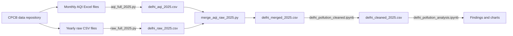
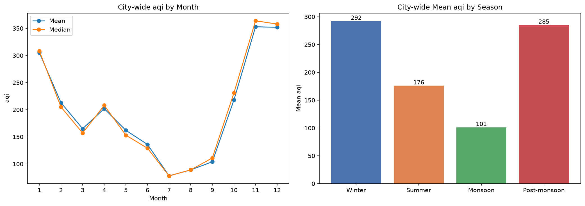
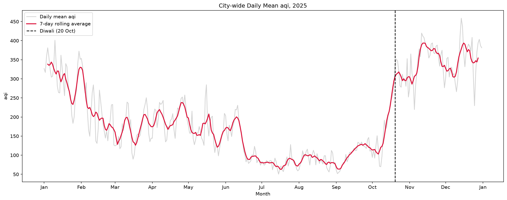
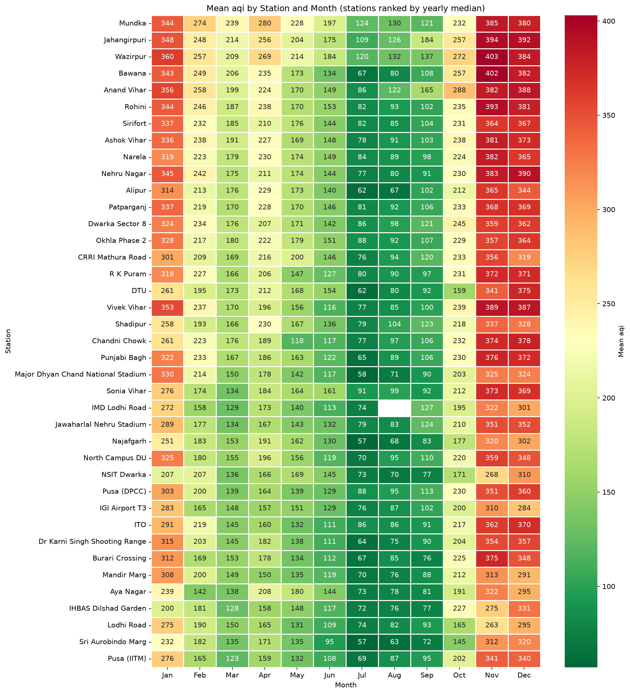
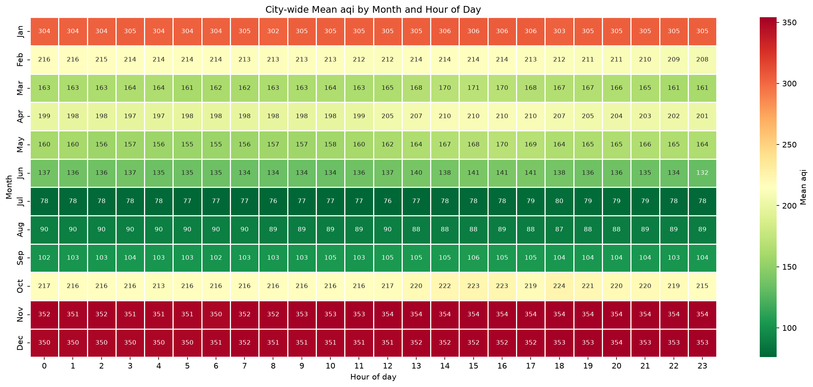
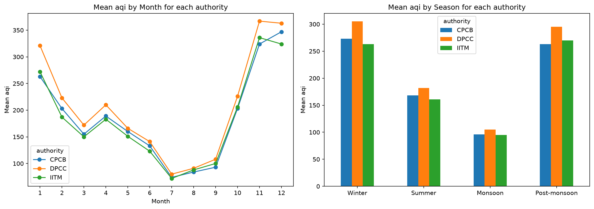
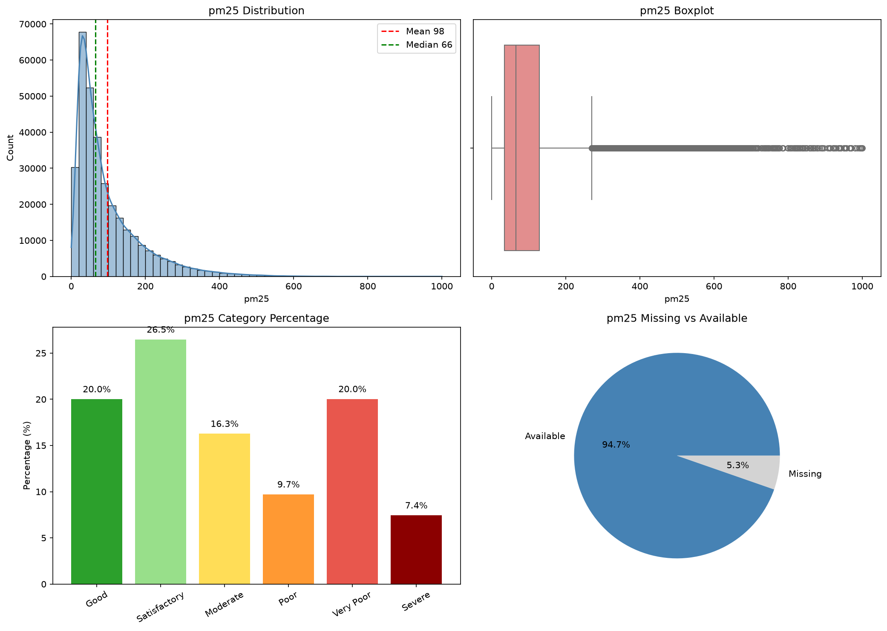

# Delhi Air Quality Analysis 2025


An end-to-end analysis of **hourly air quality across 39 Delhi monitoring stations for the whole of 2025**, built from raw government data. The project covers every step: collecting CPCB files, building datasets, merging, cleaning, and analysing.

**In short:** Delhi's air in 2025 was Poor or worse for about 42% of station-hours, with a sharp seasonal swing. Monthly average AQI ranged from **78 in July to 353 in November**.

---

## Key findings

| # | Finding | Evidence |
|---|---------|----------|
| 1 | **Strong seasonality.** Winter (292) and post-monsoon (285) are about three times worse than monsoon (101). | Mean AQI by season |
| 2 | **November and December were the worst months**, with monthly mean AQI of 353 and 352. July was the cleanest at 78. | Monthly means |
| 3 | **Pollution was persistent, not just a few bad days.** City-wide daily AQI stayed above 200 from 14 Oct to 31 Dec (79 days in a row). The longest run above 300 lasted 23 days (7 to 29 Nov). | Streak analysis |
| 4 | **Peak and low days:** the worst day was **14 Dec (daily mean AQI 459)** and the cleanest was **15 Jul (50)**. | Daily means |
| 5 | **Diwali (20 Oct) was a spike on top of a rising season.** Daily AQI rose from 247 (17 Oct) to 352 (21 Oct), then fell back to 282 by 24 Oct. But AQI had already passed 200 by 14 Oct and stayed higher through Nov and Dec. | Daily series |
| 6 | **Hotspots.** By median AQI the five worst stations were Mundka, Jahangirpuri, Wazirpur, Bawana and Anand Vihar. Station yearly means ranged from 162 to 245, and 17 of 39 stations averaged above 200. | Station ranking |
| 7 | **Only 2.1% of station-hours were rated Good.** About 18.9% were Poor, 17.9% Very Poor and 5.3% Severe. | AQI category shares |
| 8 | **Temperature and wind move with AQI, but season drives much of it.** Temperature vs AQI has r = -0.57 and wind speed r = -0.17. Calm hours (wind 0.5 m/s or less) averaged AQI 229, against 157 when wind was above 3 m/s. | Correlation analysis |
| 9 | **Hourly AQI looks flat (196 to 202 across the day), but raw PM2.5 is not.** PM2.5 falls to about 66 µg/m³ at 4 pm and climbs to about 115 µg/m³ around midnight. AQI is built from running averages, which smooths this out. | Hour-of-day analysis |

For a longer write-up, see **[Delhi_Air_Quality_2025_Conclusions.pdf](Delhi_Air_Quality_2025_Conclusions.pdf)**.

---

## Dataset at a glance

| | |
|---|---|
| **Source** | [CPCB Central Control Room for Air Quality Management, CAAQM Data Repository](https://airquality.cpcb.gov.in/ccr/#/caaqm-dashboard-all/caaqm-landing/caaqm-data-repository) |
| **Period** | 1 Jan 2025 00:00 to 31 Dec 2025 23:00 |
| **Stations** | 39 (24 DPCC, 9 IITM, 6 CPCB) |
| **Rows** | 341,640 (39 stations x 8,760 hours) |
| **Variables** | AQI; pollutants (PM2.5, PM10, NO, NO2, NOx, NH3, SO2, CO, Ozone, Benzene, Toluene); weather (temperature, humidity, wind speed and direction, rainfall, solar radiation, pressure) |
| **Missing AQI** | 7.7% of hours |

The data came in two separate downloads:

- **AQI files:** one Excel file per station per month, with one row per day and 24 hourly columns.
- **Raw parameter files:** one CSV per station per year, with one row per hour.

The pipeline below turns both into a single tidy table.

---

## Pipeline



1. **`aqi_full_2025.py`** reads the monthly AQI Excel files, parses station ID, name, city and authority from each file name, standardises the hour headers to `HH:MM`, and writes one wide CSV.
2. **`raw_full_2025.py`** reads the yearly raw CSVs per station, keeps the useful columns, and writes one long CSV.
3. **`merge_aqi_raw_2025.py`** reshapes the AQI table from wide to long, then left-joins it onto the raw data using `station_id + date + time`. It includes safety checks: the key must be unique in both tables, hour labels must match, and the row count must not change.
4. **`delhi_pollution_cleaned.ipynb`** cleans the merged data (details below).
5. **`delhi_pollution_analysis.ipynb`** runs the analysis and produces the charts.

---

## Data cleaning

The raw files contain sensor faults, placeholder zeros and frozen readings, so cleaning was a large part of this project. Bad values were set to missing rather than guessed, so the analysis never rests on invented numbers.

- **Stations:** removed 6 stations with at least 75% missing in AQI, PM2.5 and PM10, and removed IIT Delhi (only 2 months of data). 46 station IDs became 39. Two stations both named "Pusa" were renamed by authority.
- **Columns:** dropped 5 columns that were more than 50% empty (Xylene, O-Xylene, Eth-Benzene, MP-Xylene, VWS).
- **Frozen sensors:** a value repeated for too many hours in a row at one station was treated as a stuck sensor and removed, with a threshold chosen for each variable.
- **Physical plausibility checks:**
  - PM2.5 above PM10 (by more than 10%) is impossible, so both were removed.
  - Wind speed above 15 m/s appeared in only two fault episodes and no neighbouring station agreed.
  - A 16-hour carbon monoxide fault at Burari Crossing (about 48 mg/m³ against a normal 1) was removed.
  - Night-time solar radiation above 50 W/m² was removed, and four stations with faulty solar sensors were blanked.
- **Cross-station checks:** temperature and humidity readings far from the city median at the same hour were flagged. Humidity readings from a station that drifted far from the city median for a whole month were blanked for that month.
- **Fake zeros:** stations that reported only zeros for rainfall, toluene or benzene have no real sensor, so those columns were set to missing.
- **Unit fix:** Anand Vihar reported pressure in mmHg, so it was converted to hPa to match the other stations.
- **Output:** 32 columns reduced to 24, no duplicate station-hours, and no negative values.

---

## Analysis and visuals

**Methods used:** descriptive statistics, AQI category banding (CPCB bands), time-series aggregation and rolling averages, streak detection, Pearson and Spearman correlation, Kruskal-Wallis and Mann-Whitney tests with Bonferroni correction, bootstrap confidence intervals, and heatmaps.

### Seasonal pattern
AQI climbs from the monsoon low in July to a sustained peak in November and December.



### Daily AQI through the year, with Diwali marked
The 7-day average shows the October rise, the Diwali spike, and the long winter plateau.



### Station by month
Stations are ranked by yearly median AQI. The top-ranked stations are also among the worst in the cold months.



### Month by hour of day
AQI barely changes by hour because it is computed from running averages. The month matters far more than the hour.



### By monitoring authority
DPCC stations read highest in every season. This difference is statistically significant but small in size (epsilon-squared of about 0.007), and it also reflects where each network places its stations.



### PM2.5 distribution
PM2.5 is strongly right-skewed (mean 98, median 66 µg/m³), so the mean overstates the typical reading.



---

## Limitations

- **One year only.** The data cannot show trends or year-on-year change.
- **Gaps in AQI.** 7.7% of AQI hours are missing, and the gaps are uneven. January has the most (16.9%), and IMD Lodhi Road has no AQI at all for August.
- **Sparse weather data.** Rainfall (47%), pressure (46%), solar radiation (37%) and temperature (35%) are heavily missing, so each weather comparison uses only the rows where both variables exist.
- **City-wide figures are simple averages** across reporting stations. They are not weighted by area or population.
- **Authority comparisons are not like-for-like.** DPCC, CPCB and IITM stations are in different places, so differences reflect location as well as network.
- **Correlation is not causation.** Temperature, wind and rainfall all change with season, so season affects every one of those relationships.
- **Cleaning involves judgement.** Thresholds (for example, how many repeated hours count as frozen) were chosen from the data and domain knowledge, and other reasonable choices would change some numbers slightly.
- **No source attribution.** The analysis shows when and where pollution was high, not what caused it.

---

## Repository structure

```
delhi_airpollution_analysis/
├── data/               # merged and cleaned CSVs
├── images/             # charts used in this README
├── python_notebook/    # cleaning and analysis notebooks
├── python_script/      # data collection and merge scripts
├── Delhi_Air_Quality_2025_Conclusions.pdf
├── requirements.txt
├── LICENSE
└── README.md
```

---

## How to run

**Option A: explore the analysis (fastest).** The cleaned data is already in `data/`.

```bash
git clone https://github.com/sunnykashyapp/delhi_airpollution_analysis.git
cd delhi_airpollution_analysis
pip install -r requirements.txt
jupyter notebook python_notebook/delhi_pollution_analysis.ipynb
```

**Option B: rebuild everything from CPCB downloads.**

1. Download the monthly AQI Excel files and the yearly raw CSV files from the [CPCB data repository](https://airquality.cpcb.gov.in/ccr/#/caaqm-dashboard-all/caaqm-landing/caaqm-data-repository).
2. Edit the `FOLDER`, `OUTPUT` and path variables at the top of each script and notebook. They are currently set to the author's local Windows folders.
3. Run the scripts in order: `aqi_full_2025.py`, then `raw_full_2025.py`, then `merge_aqi_raw_2025.py`.
4. Run `delhi_pollution_cleaned.ipynb`, then `delhi_pollution_analysis.ipynb`.

The raw Excel and CSV downloads are not stored in this repository because of their size. Reading `.xlsx` files needs the `openpyxl` package.

---

## Tools and skills shown

Python, pandas, NumPy, matplotlib, seaborn, SciPy, Jupyter. Data wrangling across inconsistent file formats, regular expressions for parsing file names, data validation and quality checks, time-series analysis, statistical testing, and data visualisation.

---

## Data source and licence

- **Data:** published by the Central Pollution Control Board (CPCB), Government of India, through its air quality data repository. The data belongs to CPCB. Please check CPCB's terms of use before reusing or redistributing it.
- **Code:** released under the [MIT License](LICENSE).

---

## Author

**Sunny Kashyap**

- Email: [kashyapsunny0134@gmail.com](mailto:kashyapsunny0134@gmail.com)
- LinkedIn: [sunnykashyap1111](https://www.linkedin.com/in/sunnykashyap1111)
- GitHub: [sunnykashyapp](https://github.com/sunnykashyapp)

If you found this useful or have feedback, feel free to get in touch.
